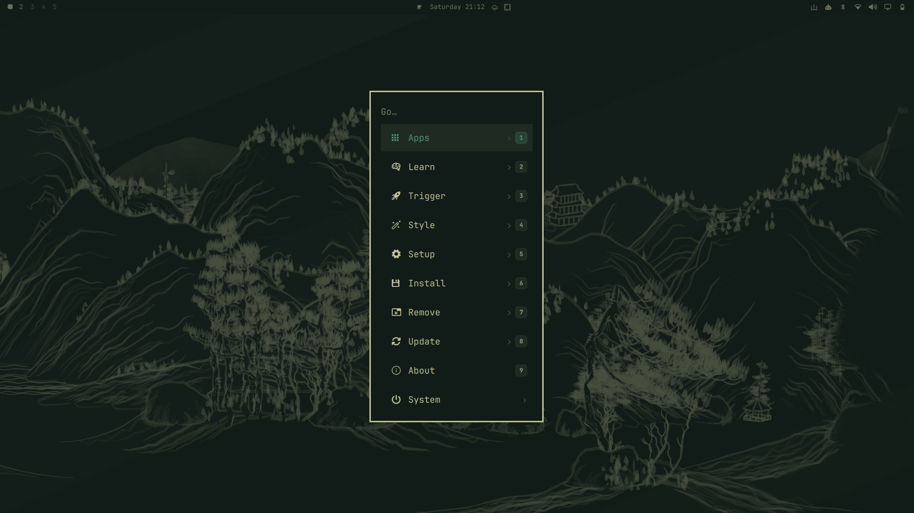

# Omarchy QuickNum

[Deutsch](README.de.md) · **English**

[](https://omarchy.org)
[](https://github.com/W3asd/omarchy-quicknum/releases)
[](LICENSE)
[](#ai-generated)

**QuickNum** is a plugin for [Omarchy](https://omarchy.org/). It replaces the
built-in Omarchy menu with a version where you choose each of the first nine
rows directly with the number keys `1`–`9` (or the numpad). Right-aligned badges show the numbers.



> [!NOTE]
> <a id="ai-generated"></a>**This project is fully AI-generated.** The first version was created with
> Google Antigravity. Bug fixes and documentation were done with Claude Code
> (Anthropic). Each change is tested on a real Omarchy system, but the code
> was not written by hand. Please keep this in mind and review the
> code before you enable it. Plugins run unsandboxed inside `omarchy-shell`.

## Features

- **Number keys and numpad `1`–`9`** run the matching row immediately, so you
  can step through nested menus quickly (e.g. `3` → `1`).
- **Right-aligned badges:** long titles are truncated with `…`, so the badges always line up.
- **Search as usual:** typing filters the list, and the badges follow the results.
  Once a search has started, digits are typed into it.
- **Drop-in replacement:** the manifest declares `clonedFrom: "omarchy.menu"`,
  so existing shortcuts (`Super + Space`, `Super + Alt + Space`) open QuickNum
  without any config changes.

## Compatibility

| Omarchy | Status |
|---|---|
| 4.0.6 | tested (2.0.0) |
| 4.0.x | expected to work; the Apps workaround is active ([details](docs/known-issues.md)) |
| ≥ 4.5 | not tested yet; the upstream fix there should make the workaround inactive |

Some problems come from Omarchy itself, not from QuickNum: the empty Apps list on 4.0.x, and a numpad that
types nothing until NumLock is toggled. The [known issues](docs/known-issues.md#overview-omarchy-issues-that-affect-quicknum)
list them with links to the Omarchy issues.

## Installation

```bash
omarchy plugin add https://github.com/W3asd/omarchy-quicknum.git
```

Review the code, then enable QuickNum. Enabling it switches off the built-in
`omarchy.menu` and takes over its place in the bar (tested on Omarchy 4.0.6):

```bash
omarchy plugin enable w3asd.quicknum
```

Manual alternative: clone the repository to `~/.config/omarchy/plugins/w3asd.quicknum`
and run `omarchy-shell shell rescanPlugins`, or run `./bin/install.sh` from the repository.

## Upgrading from 1.x

Version 2.0 renamed the plugin id from `quicknum` to `w3asd.quicknum`. Remove the old install, then install again:

```bash
omarchy plugin disable quicknum
omarchy plugin remove quicknum
omarchy plugin add https://github.com/W3asd/omarchy-quicknum.git
omarchy plugin enable w3asd.quicknum
```

## Uninstall / back to the built-in menu

```bash
omarchy plugin disable w3asd.quicknum
```

This switches the built-in `omarchy.menu` back on. `omarchy plugin remove w3asd.quicknum` also deletes the files.

## Keys

| Key | Action |
| :--- | :--- |
| `Super + Space` / `Super + Alt + Space` | Open / close the menu |
| `1`–`9`, numpad `1`–`9` | Run row 1–9 (while the search is empty); the numpad works even if NumLock is out of sync ([details](docs/known-issues.md#numpad-acts-as-if-numlock-were-off-after-hovering-a-window-worked-around)) |
| `A`–`Z`, then also `0`–`9` | Search |
| `Enter` | Run the selected row |
| `Backspace` / `Left` | Up one level (when the search is empty) |
| `Esc` | Clear the search, then close the menu |
| `Up` / `Down` | Move the selection |

The existing Omarchy shortcuts open QuickNum, because its manifest declares
`clonedFrom: "omarchy.menu"`. To bind it to another key anyway, call
`omarchy-shell shell toggle w3asd.quicknum '{"menu":"root"}'` from `~/.config/hypr/bindings.lua`.

## Settings

These properties are at the top of `Menu.qml`:

- `quickNumEnabled` (default `true`): turns number-key selection on or off.
- `quickNumInSearch` (default `false`): with `false`, number keys select rows
  only while the search is empty; once you type a letter, digits go into the
  search. With `true`, number keys always select.
- `quickNumBadgeStyle` (default `"badge"`): `"badge"` or `"minimal"`.
- `quickNumKeypadAlwaysDigits` (default `true`): numpad keys always count as
  digits, even if NumLock is out of sync. Set it to `false` if you use the numpad
  with NumLock off as arrow keys in the menu.

## Repository layout

```
manifest.json          Omarchy plugin manifest (clonedFrom: omarchy.menu)
Menu.qml               Menu, based on Omarchy's built-in menu, plus QuickNum
MenuModel.js           Unchanged copy of Omarchy's menu model (4.0.6)
QuickNumIndicator.qml  Number badges
BarWidget.qml          Optional bar button
bin/install.sh         Local install script
bin/omarchy-quicknum   CLI helper (toggle, summon, close, refresh, ping); run it from the repository, it is not installed to PATH
tests/validate.sh      Manifest and syntax checks
docs/                  Known issues, development notes, screenshot
```

## Documentation

- [Known issues](docs/known-issues.md)
- [Development and testing](docs/development.md)
- [Changelog](CHANGELOG.md)
- [Contributing](CONTRIBUTING.md)

## License

[MIT](LICENSE). `Menu.qml` and `MenuModel.js` are derived from
[Omarchy](https://github.com/omacom/omarchy) (MIT, © David Heinemeier Hansson).
